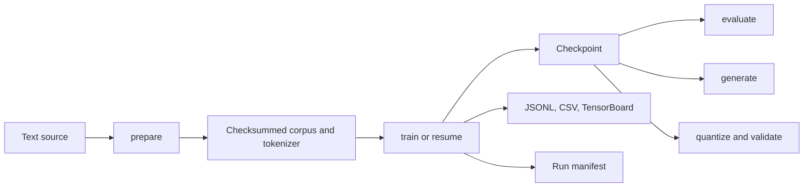

# TinyLLM

TinyLLM is my compact, decoder-only language-model project: data preparation, tokenizer
training, pre-training, deterministic resume, evaluation, cached generation, precision
benchmarking, and inference export in one readable PyTorch codebase. I built it to make every
stage inspectable, from corpus checksums to grouped-query attention and atomic checkpoints.

Current default configuration contains 39,854,592 trainable parameters. `tinyllm train
--dry-run` computes this value from configuration instead of relying on a stale estimate.



## What is included

- streaming preparation from `codelion/fineweb-edu-100M`, with deterministic train/validation
  split, locally trained BPE tokenizer, SHA-256 identities, and atomic artifact publication;
- pre-norm Transformer blocks with RMSNorm, RoPE, grouped-query attention, SwiGLU, tied input
  and output embeddings, and one KV cache per layer;
- single-device training with FP32, FP16, BF16, or optional FP8, gradient accumulation,
  validation metrics in JSONL/CSV and TensorBoard, atomic checkpoints, and deterministic resume;
- greedy or sampled generation with rolling context, precision comparison, and reload-verified
  BF16, FP16, INT8, or INT4 inference exports;
- CPU test suite plus separately marked CUDA smoke tests.

Architecture details live in [docs/architecture.md](docs/architecture.md). RTX 5080 setup and
benchmark procedure live in [docs/training-rtx-5080.md](docs/training-rtx-5080.md).

## Windows quick start with uv

Requirements: Windows 10 or newer, Git, and Python 3.12. `uv` publishes an official Windows
installer and Windows x86-64 binaries: [uv installation guide](https://docs.astral.sh/uv/getting-started/installation/).

```powershell
winget install --id=astral-sh.uv -e
git clone <repository-url> TinyLLM
cd TinyLLM
uv sync --extra dev
uv run pytest -m "not cuda"
uv run tinyllm --help
```

`uv sync` is enough for CPU development and tests. CUDA wheels depend on current PyTorch and
driver compatibility; select Windows, Pip, Python, and matching CUDA on the official
[PyTorch installer](https://pytorch.org/get-started/locally/), then run its generated command
inside this environment. Confirm actual runtime before training:

```powershell
uv run python -c "import torch; print(torch.__version__, torch.cuda.is_available(), torch.version.cuda)"
```

TorchAO is optional. Install project extra only when testing FP8 or INT8/INT4 paths:

```powershell
uv sync --extra dev --extra fp8
```

Installation alone does not guarantee kernel support. FP8 command probes requested CUDA device
and real forward/backward kernel; unsupported combinations fail with reason instead of silently
falling back. TorchAO documents current
[quantized training](https://docs.pytorch.org/ao/stable/workflows/training.html) and
[quantized inference](https://docs.pytorch.org/ao/stable/workflows/inference.html) support.

## Prepare and inspect data

Default source is [`codelion/fineweb-edu-100M`](https://huggingface.co/datasets/codelion/fineweb-edu-100M),
a 100M-token reservoir sample of
[`HuggingFaceFW/fineweb-edu`](https://huggingface.co/datasets/HuggingFaceFW/fineweb-edu).
Preparation resolves remote revision, records upstream fingerprint, trains tokenizer, writes
`uint16` token artifacts, and validates every checksum before publication.

```powershell
uv run tinyllm prepare --config configs/tinyllm.yaml
uv run tinyllm inspect-data --config configs/tinyllm.yaml
uv run tinyllm audit-artifacts --manifest data/processed/manifest.json
```

`audit-artifacts` reads a manifest and its referenced tokenizer and token files without changing
them. It works offline without loading a model or initializing CUDA, prints a JSON report, and
returns a failing exit code when it finds invalid metadata, missing or truncated files, checksum
mismatches, tokenizer identity changes, or token IDs outside the vocabulary. Legacy manifests
remain untouched and produce a compatibility warning.

Outputs never overwrite by default. Rebuilding intentional dataset requires explicit
`--overwrite`. For offline smoke run, set `data.dataset_name` to local UTF-8 text file; each
non-empty line becomes one document.

Dataset card for 100M sample does not declare separate license. Upstream FineWeb-Edu card
declares [Open Data Commons Attribution 1.0](https://opendatacommons.org/licenses/by/1-0/).
Web documents can retain their own terms and sensitive or inaccurate content; inspect source
card and intended use before redistributing artifacts or outputs.

### Disk planning

Dataset card currently reports 329 MB Parquet download. One 100M-token `uint16` corpus is about
200 MB before filesystem overhead. Download cache, staging files, tokenizer, logs, and prepared
corpus can coexist, so reserve at least 1 GB for data work. Default model checkpoint after AdamW
state initialization is expected to occupy several hundred MB; multiple checkpoints and exports
make several GB prudent. These are capacity estimates from file formats and parameter count, not
measured throughput or memory results.

## Train, resume, evaluate, generate

Validate configuration without allocating CUDA training state or starting optimizer steps:

```powershell
uv run tinyllm train --config configs/tinyllm.yaml --dry-run
```

Dry run validates available dataset identity, computes parameter count, effective batch, tokens
per optimizer step, requested precision, and target device. Default effective batch is 16 micro
sequences times 8 accumulation steps: 128 sequences or 65,536 tokens per optimizer step.

```powershell
uv run tinyllm train --config configs/tinyllm.yaml --max-steps 20 --checkpoint checkpoints/latest.pt
uv run tinyllm train --config configs/tinyllm.yaml --resume checkpoints/latest.pt --checkpoint checkpoints/resumed.pt --max-steps 10000
uv run tinyllm evaluate --config configs/tinyllm.yaml --checkpoint checkpoints/resumed.pt --batches 8
uv run tinyllm generate --checkpoint checkpoints/resumed.pt --prompt "Once upon a time"
```

Checkpoint stores model, optimizer, schedule boundary, precision state, Python/PyTorch/CUDA RNG,
loader RNG, full configuration snapshot, and model/tokenizer/corpus identities. Resume rejects
incompatible configuration or artifacts before mutation. Generation can recover configuration
from checkpoint; pass `--config` when intentionally validating against external configuration.
Default configuration keeps `training.max_steps: 10000`; first command stops early through CLI
without changing checkpoint configuration snapshot. Resume therefore remains configuration-compatible
and continues toward step 10000.

`Ctrl+C` and `SIGTERM` finish the current optimizer step, write a resumable `interrupt.pt` in the
checkpoint directory, then stop. Abrupt termination that cannot deliver a signal can only resume
from the latest periodic `step-*.pt` checkpoint.

### Training metrics

Each training report appends one record to `runs/metrics.jsonl` and one row to
`runs/metrics.csv`. TensorBoard remains available in `runs/tensorboard`. JSONL and CSV flush after
each report. A CSV schema change adds columns while preserving earlier rows.

`timestamp_utc` is the record time in ISO 8601 UTC. `run_id` matches `runs/run.json`; `session_id`
identifies one training process. Resuming keeps the run ID and starts a new session, so repeated
step numbers remain distinguishable. Steps increase within each session.

- `loss`, `validation_loss`: mean training loss and latest validation loss, unitless. `validation_step`
  gives the step used for that validation value. Perplexity fields are exponentiated losses.
- `learning_rate`: optimizer learning rate at the reported step. `gradient_norm`: gradient norm
  before clipping.
- `tokens_processed`: cumulative tokens in the run. `tokens_per_second` and `sequences_per_second`
  cover the training interval since the previous report; validation and metric writes are excluded.
- `data_loading_seconds`: time spent waiting for prefetched training batches in that interval.
  `evaluation_seconds`: time spent evaluating validation data in the interval.
- `elapsed_seconds`: wall time since the current session started. `peak_vram_bytes`: peak allocated
  CUDA memory since the last reset. `cuda_free_memory_bytes` and `cuda_total_memory_bytes` record
  free and total CUDA memory at report time; CUDA fields are absent on CPU runs.

### Reproducible evaluation

Evaluation defaults to the validation split, 8 batches, and seed 42. Each batch samples token
windows with replacement from the selected corpus split. The local evaluation generator leaves
training loader state unchanged. `--tokens` requests an exact target-token count; the last window
is shortened when needed. Every target token, including EOS, contributes to loss. The model's
causal attention mask remains active.

```powershell
uv run tinyllm evaluate --config configs/tinyllm.yaml --checkpoint checkpoints/resumed.pt --split validation --batches 8 --seed 42
uv run tinyllm evaluate --config configs/tinyllm.yaml --checkpoint checkpoints/resumed.pt --split validation --tokens 100000 --seed 42 --output runs/evaluation.json
uv run tinyllm evaluate --config configs/tinyllm.yaml --checkpoint checkpoints/resumed.pt --split validation --tokens 100000 --seed 42 --output runs/evaluation.csv
```

Reports include checkpoint and selected corpus SHA-256, split, seed, requested and actual token
counts, batch count, mean next-token loss, population standard deviation across batch mean losses,
and perplexity. Loss and its dispersion use nats per predicted token; perplexity is the exponential
of token-weighted mean loss and has no unit. For numeric safety, values above `exp(80)` are capped;
`perplexity_saturated` marks this case. JSON and CSV output refuse to replace an existing file
unless `--overwrite` is passed. Human-readable lines go to stderr; stdout remains one JSON object
for scripts. The JSON keeps the existing `validation_loss` and `validation_perplexity` fields.

For repeat runs with the same checkpoint, corpus, split, seed, batch or token limit, device, dtype,
PyTorch version, and CUDA runtime, compare floating-point results with relative tolerance `1e-4`
and absolute tolerance `1e-6`. This tolerance does not promise equivalence across devices, dtypes,
or software versions.

One-off overrides use validated dotted YAML scalars:

```powershell
uv run tinyllm train --config configs/tinyllm.yaml --set training.max_steps=2000 --set training.warmup_steps=100 --dry-run
```

Unknown keys and invalid values fail validation. Keep `training.warmup_steps` below
`training.max_steps`.

## BF16/FP8 benchmark

Benchmark modes receive same initialized weights, seed, batch shapes, and pre-generated token
batches. Warmup is excluded; CUDA synchronization brackets measured section. Results include
tokens/s, elapsed time, peak allocated/reserved bytes, mean loss, and finite-loss flag.

```powershell
uv run tinyllm benchmark-precision --config configs/tinyllm.yaml --modes bf16 fp8 --warmup-steps 10 --measured-steps 50 --output runs/precision-benchmark.json
```

Existing output is refused unless `--overwrite` is explicit. Compare local results only after
confirming same software, configuration, thermals, and background load.

Sample reporting table, intentionally unpopulated until local hardware run:

| Mode | Tokens/s | Peak allocated | Peak reserved | Mean loss | Finite |
| --- | ---: | ---: | ---: | ---: | --- |
| BF16 | — | — | — | — | — |
| FP8 | — | — | — | — | — |

## BF16, FP16, INT8, and INT4 export

```powershell
uv run tinyllm quantize --config configs/tinyllm.yaml --checkpoint checkpoints/resumed.pt --recipe bf16 --output exports/tinyllm-bf16.pt
uv run tinyllm quantize --config configs/tinyllm.yaml --checkpoint checkpoints/resumed.pt --recipe int8 --output exports/tinyllm-int8.pt
uv run tinyllm quantize --config configs/tinyllm.yaml --checkpoint checkpoints/resumed.pt --recipe int4 --output exports/tinyllm-int4.pt
```

BF16/FP16 direct exports require supported execution dtype. INT8/INT4 are TorchAO weight-only
paths and remain conditional on compatible library version, device, serialization support, and
kernels. Export succeeds only after strict reload and deterministic numeric round trip. Existing
destination is preserved on failure and replaced only with `--overwrite`.

## Limitations

- single process and single device; no distributed training;
- 512-token default context and compact parameter budget;
- pre-training only: no instruction tuning, preference tuning, safety tuning, or factuality
  guarantee;
- dataset is predominantly English web text and can carry source bias, duplication, personal
  data, or unsafe material;
- default 100M-token sample is useful for experiments, not competitive general-purpose quality;
- FP8, INT8, and INT4 support must be established on target hardware; CPU tests cannot validate
  CUDA kernel availability or speed;
- benchmark output is local evidence, never universal hardware claim.

## Attribution

- 100M sample: [codelion/fineweb-edu-100M dataset card](https://huggingface.co/datasets/codelion/fineweb-edu-100M)
- upstream corpus: [HuggingFaceFW/fineweb-edu dataset card](https://huggingface.co/datasets/HuggingFaceFW/fineweb-edu)
- FineWeb paper: [The FineWeb Datasets: Decanting the Web for the Finest Text Data at Scale](https://arxiv.org/abs/2406.17557)
- dataset sampling context: [The 1 Billion Token Challenge](https://huggingface.co/blog/codelion/optimal-dataset-mixing/)
- PyTorch, Hugging Face Datasets, Tokenizers, TensorBoard, Pydantic, PyYAML, and optional
  TorchAO power runtime and tooling.
